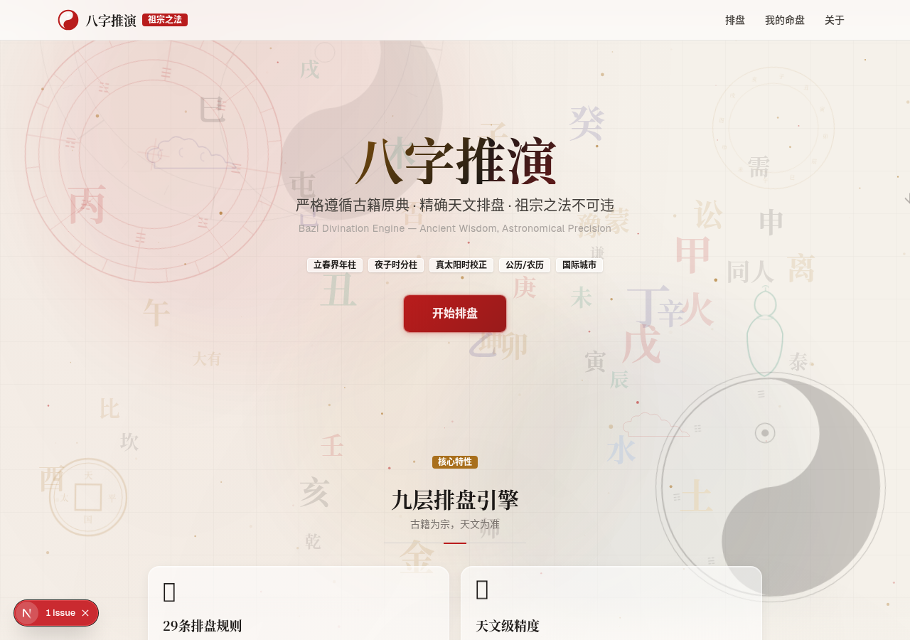
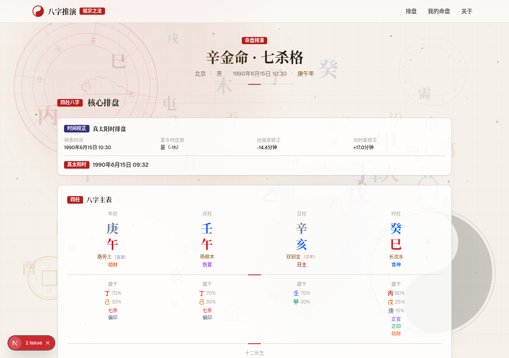

<div align="center">

# 八字推演

### Bazi Divination Engine

**严格遵循古籍原典的八字排盘与命理分析工具**

*祖宗之法不可违 · 精确天文排盘 · 纯客户端计算*

[](https://bazi-tuiyan.vercel.app/)
[](https://github.com/ElijahZhao/bazi-tuiyan/actions/workflows/ci.yml)
[](https://nextjs.org/)
[](https://react.dev/)
[](https://www.typescriptlang.org/)
[](LICENSE)

</div>

---

## 这是什么

「八字推演」是一款基于中国传统命理学的 Web 应用。它把生辰信息（公历/农历 + 性别 + 出生地）转成完整命盘——**四柱、大运流年、十神、神煞、旺衰格局**——全部计算在浏览器本地完成，不出网、不上传。规则取自《三命通会》《渊海子平》《子平真诠》等 12 部古籍原典，天文历法以中国科学院紫金山天文台数据为校准基准。

> 在线体验：**[bazi-tuiyan.vercel.app](https://bazi-tuiyan.vercel.app/)**

---

## 核心亮点

- 📜 **规则可溯源**：29 条排盘规则逐条对应古籍出处，每条都能查到来源与映射表。
- 🔭 **天文级时间精度**：基于 astronomy-engine（VSOP87 + DE440），节气偏差小于 30 秒；真太阳时校正包含经度差、均时差与夏令时还原。
- 🌍 **188 座城市**：含中国 87 座、覆盖六大洲，自动匹配经度与时区；也支持手动输入经度。
- 🖥 **纯客户端计算**：排盘零网络依赖、零延迟，出生信息不上传服务器。
- 🤖 **AI 古法断语（可选）**：基于命理知识库组织语言，仅润色表达、不引入规则库外断语，支持多轮追问。

---

## 效果预览

<div align="center">

**首页 · 输入与核心特性**



**命盘页 · 四柱与格局分析**



</div>

---

## 快速开始

```bash
git clone https://github.com/ElijahZhao/bazi-tuiyan.git
cd bazi-tuiyan
npm install
npm run dev
```

打开 [http://localhost:3000](http://localhost:3000) 即可使用。

**环境要求**：Node.js >= 20.9，npm >= 9。

**常用脚本**

| 命令 | 用途 |
| --- | --- |
| `npm run dev` | 启动开发服务器 |
| `npm run build` | 生产构建 |
| `npm run start` | 运行生产构建 |
| `npm run lint` | ESLint 检查 |
| `npm run typecheck` | TypeScript 类型检查 |
| `npm test` | 运行单元测试（Vitest） |

**启用 AI 解读（可选）**：排盘核心功能无需任何环境变量。如需 AI 润色解读，复制 `.env.example` 为 `.env.local` 并填入：

```env
ARK_API_KEY=your_api_key
ARK_MODEL_ID=your_model_id
```

---

## 目录结构

```
bazi-tuiyan/
├── src/
│   ├── app/                          # Next.js App Router
│   │   ├── page.tsx                  # 首页（排盘输入表单）
│   │   ├── chart/page.tsx            # 命盘展示页
│   │   ├── saved/page.tsx            # 已保存命盘
│   │   ├── about/page.tsx            # 关于页（来源与校验说明）
│   │   ├── api/interpret/route.ts    # AI 解读 API Route
│   │   ├── layout.tsx                # 全局布局（含背景特效）
│   │   └── globals.css               # 设计系统 + 动画
│   │
│   ├── components/
│   │   ├── animations/               # 背景特效（visual-effects / gsap-effects）
│   │   ├── charts/                   # 五行雷达 / 十二长生 / 大运时间轴 / 旺衰热力图
│   │   ├── interpretation/           # AI 解读面板（支持追问）
│   │   └── disclaimer.tsx            # 免责声明组件
│   │
│   └── lib/
│       ├── engine/                   # 排盘引擎核心（纯函数，含 __tests__/）
│       ├── interpretation/           # 命理知识库（AI 解读用）
│       ├── lunar-utils.ts            # 农历工具
│       ├── storage.ts                # 本地存储（命盘 / 对话）
│       └── utils.ts                  # 通用工具
│
├── docs/
│   ├── 项目大纲.md                    # 功能规格总纲
│   └── 参考来源文件.md                # 权威来源总纲
│
├── public/screenshots/               # README 展示截图
├── .github/workflows/ci.yml          # CI：lint + typecheck + test + build
├── vitest.config.ts                  # 测试配置
├── next.config.ts                    # Next.js 配置
├── SECURITY.md                       # 安全政策
├── LICENSE                           # MIT
└── package.json
```

---

## 技术栈

| 类别 | 技术 | 说明 |
| --- | --- | --- |
| 框架 | Next.js 16.4 | App Router + Turbopack |
| UI | React 19.2 | 函数组件 + Hooks |
| 语言 | TypeScript 5.x | 全量类型安全 |
| 样式 | Tailwind CSS v4 | 原子化 CSS + 设计系统 |
| 天文计算 | astronomy-engine 2.1 | VSOP87 + DE440 |
| 农历转换 | lunar-typescript 1.8 | 农历 / 公历互转 |
| 动画 | GSAP 3.15 + Framer Motion 13 | ScrollTrigger + 入场动画 |
| 图表 | ECharts 6.1 | 雷达图 / 时间轴 / 热力图 |
| 图标 | Lucide React 1.31 | 图标库 |
| 测试 | Vitest 4.1 | 9 个模块、346 项用例 |
| 部署 | Vercel | 边缘节点部署 |

---

## 常见问题

<details>
<summary><b>排盘需要联网吗？出生信息会上传服务器吗？</b></summary>

不需要联网，也不会上传。排盘引擎是纯客户端的 TypeScript 纯函数库，出生信息只停留在你的浏览器里。只有当你**主动使用 AI 解读**时，才会把命局特征发送给所配置的大模型服务。
</details>

<details>
<summary><b>AI 解读没有反应或报错？</b></summary>

未配置 `ARK_API_KEY` 时，接口会自动降级为「规则库特征摘要」，不会静默失败。配置密钥后即可获得完整的 AI 润色解读。若配置后仍报错，界面会显示服务端返回的真实错误，便于排查额度、鉴权或模型 ID 问题。
</details>

<details>
<summary><b>支持哪些年份与城市？</b></summary>

公历 / 农历互转覆盖 1900–2100，支持闰月；节气与四柱按天文算法计算。城市内置 188 座（含中国 87 座、六大洲），选择城市会自动填入经度与时区，也可手动输入。
</details>

<details>
<summary><b>「夜子时分柱」和「立春界年柱」是什么意思？</b></summary>

- **立春界年柱**：以立春交节时刻而非农历正月初一作为年份分界。
- **夜子时分柱**：23:00–24:00 出生时，日柱是否进位到次日，可在首页开关切换，两种流派都给到。

这与真太阳时校正一起，构成了比「按公历直接查表」更严谨的排盘口径。
</details>

<details>
<summary><b>排盘结果能当作命运预测吗？</b></summary>

不能。本站定位为传统文化学术研究与交流，排盘与解读仅供文化参考，不构成任何医疗、法律、财务、婚恋、就业等决策建议。
</details>

---

## 更新日志

当前版本 `v0.1.0`。

| 时间 | 主要变化 |
| --- | --- |
| 2026-08 | 功能成型：公历/农历双历法、国际城市、真太阳时校正、大运流年、AI 解读（流式输出 + 追问 + 对话持久化 + 多命盘隔离）、法器背景特效、全站免责声明 |
| 2026-10 | 工程化加固：接入 GitHub Actions CI、新增安全政策、升级 Next.js 至 16.4、清理死代码并消除 ESLint 错误、AI 接口增加同源校验与限流、校正文档事实口径 |

---

## 附录

<details>
<summary><b>排盘引擎：九层纯函数架构</b></summary>

每层独立可测，数据自上而下流动：

```
用户输入（公历/农历生辰 + 性别 + 出生地经度）
        │
        ▼  [客户端纯计算，无网络]
  1. 时间校正层   夏令时还原 → 经度差 → 均时差
  2. 节气计算层   定气法（太阳黄经每 15°），紫金山天文台校准
  3. 四柱排盘层   年柱（立春为界）/ 月柱（五虎遁）/ 日柱（夜子时）/ 时柱（五鼠遁）
  4. 大运流年层   顺逆 + 起运岁数（精确到天）/ 流年流月流日流时 / 小运
  5. 辅助宫位层   胎元（前三百日法）/ 命宫 / 身宫
  6. 十神关系层   地支藏干 / 十神 / 纳音 / 十二长生
  7. 神煞层       天乙 / 文昌 / 华盖 / 驿马 / 桃花 / 羊刃 等 25+ 种
  8. 关系分析层   刑冲合害破 / 暗合 / 拱夹虚邀 / 三合三会
  9. 旺衰格局层   日主旺衰（得令得地得势）/ 格局判定 / 用神喜忌
        │
        ▼
  完整命盘 + AI 古法断语
```
</details>

<details>
<summary><b>命盘展示项</b></summary>

- **四柱基本信息**：四柱干支、日主、纳音、十神、地支藏干
- **大运流年**：起运岁数（精确到天）、顺逆、每步大运干支、流年/流月/流日/流时、小运
- **辅助宫位**：胎元、命宫、身宫
- **关系分析**：天干五合/相冲、地支六合六冲三合三会、刑害破、暗合、拱夹虚邀
- **神煞**：天乙贵人、文昌、华盖、驿马、桃花、禄神、空亡、将星、灾煞、劫煞、孤辰寡宿、魁罡、天罗地网、金舆、天德、月德、羊刃 等
- **可视化图表**：五行雷达图、十二长生图、大运时间轴、旺衰热力图
- **AI 古法断语**：知识库润色解读 + 多轮追问，对话自动保存
</details>

<details>
<summary><b>权威来源</b></summary>

**第一级 · 国家级 / 国际级机构**

| 机构 | 用途 |
| --- | --- |
| 中国科学院紫金山天文台 (PMO) | 节气交节时刻、农历编算、历书术语 |
| 国家标准 GB/T 33661-2017 | 农历编算标准、节气黄经定义 |
| 中国科学院国家授时中心 (NTSC) | 北京时间定义（UTC(NTSC) + 8h） |
| 香港天文台 (HKO) | 历年节气时刻交叉验证 |

**第二级 · 命理古籍原典（12 部）**

| 古籍 | 作者 / 年代 | 核心引用 |
| --- | --- | --- |
| 《三命通会》 | 明 · 万民英 | 胎元、大运、子时、神煞、五行旺衰、天干化气 |
| 《渊海子平》 | 宋 · 徐子平 | 地支藏干、大运起法、五虎遁、五鼠遁、起胎法 |
| 《子平真诠》 | 清 · 沈孝瞻 | 用神取法、格局成败、顺用逆用 |
| 《穷通宝鉴》 | 清 · 余春台 | 调候用神（按季节寒暖燥湿取用） |
| 《滴天髓阐微》 | 明 · 刘伯温 | 旺衰体用、扶抑通关、通根透干 |
| 《李虚中命书》 | 唐 · 李虚中 | 古法禄命、纳音释义、天乙贵人 |
| 《命理探源》 | 清 · 袁树珊 | 夜子时/子正定义、大运起法 |
| 《星平大成》 | 清 · 沈承勋 | 夜子时阴阳属性 |
| 《五行大义》 | 隋 · 萧吉 | 天干冲破、五行生克 |
| 《千里命稿》 | 民国 · 韦千里 | 天干相克、羊刃帝旺说 |
| 《神峰通考》 | 明 · 张神峰 | 逢卯安命、逢酉安身 |
| 《古今图书集成·艺术典》 | 清 · 陈梦雷 | 身宫排法 |
</details>

---

## 免责声明

本站排盘与解读内容基于中国传统命理学古籍所载算法，属于**传统文化学术研究领域**，不代表现代科学验证结论。

- 排盘结果及 AI 解读仅供**文化参考与学术交流**
- **不构成**任何形式的医疗、法律、财务、婚恋、就业等决策建议
- AI 生成内容可能存在偏差，不得作为专业命理咨询的替代
- 排盘引擎全部纯客户端计算，出生信息**不上传服务器**

使用本站即表示您已阅读、理解并同意以上全部条款。

---

## License

[MIT](LICENSE)

---

<div align="center">

**八字推演** · 祖宗之法，排盘有据

天文数据以中国科学院紫金山天文台为最终校准基准 · 排盘引擎纯客户端计算

</div>